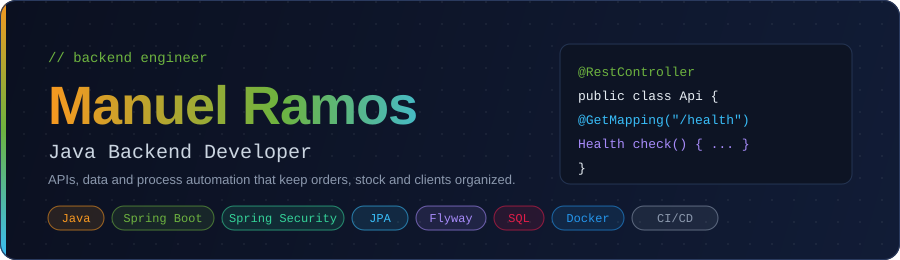

<div align="center">



<br />


</div>

## About me

```text
manuel_ramos  |  Java backend developer
```

Passionate about software development and continuous learning. I build applications with Java and I'm exploring modern backend technologies.

- Currently building backend projects with **Java + Spring Boot**
- Learning **Spring Security**, **advanced SQL**, **NoSQL** and **threads**
- Goal: write clean, well-tested and maintainable code
- Always open to learning something new

## Currently learning

| Topic | Focus | Status |
| ----- | ----- | ------ |
| Spring Security | Authentication & authorization | In progress |
| Advanced SQL | Queries & optimization | In progress |
| NoSQL | Document databases | In progress |
| Threads | Virtual + platform threads | In progress |
| English | B1+ → B2 | In progress |

## Skill levels

| Skill | Level | Progress |
| ----- | ----- | -------- |
| Java | Intermediate | ▰▰▰▱▱ |
| Spring Boot | Intermediate | ▰▰▰▱▱ |
| Spring Security | Intermediate | ▰▰▰▱▱ |
| SQL | Intermediate | ▰▰▰▱▱ |
| Git | Intermediate | ▰▰▰▱▱ |
| Maven | Basic | ▰▰▱▱▱ |
| Docker | Basic | ▰▰▱▱▱ |
| Testing | Basic | ▰▰▱▱▱ |

## Core concepts


## Featured projects

### Biz Admin — E-commerce admin panel

Admin panel for an E-commerce that centralizes products, orders, customers, coupons and inventory in a single dashboard. It solves the admin's organization problems by replacing spreadsheets and scattered tools with one place to manage the whole operation.

- **Live demo:** [application-biz-admin.vercel.app](https://application-biz-admin.vercel.app/login)
- **Frontend code:** [github.com/manuel20051208/ApplicationBizAdmin](https://github.com/manuel20051208/ApplicationBizAdmin)
- **Backend code:** [github.com/manuel20051208/Api-Project](https://github.com/manuel20051208/Api-Project)
- **Backend:** Java, Spring Boot, Spring Security, Spring Data JPA, Flyway, SQL
- **Frontend:** Next.js, React, TypeScript, Tailwind CSS
- **DevOps:** Docker, CI/CD (GitHub Actions) |

## Let's connect

[](https://www.linkedin.com/in/manuel-ramos-26065723b)

---

<sub>Thanks for stopping by. Let's build something great together.</sub>
