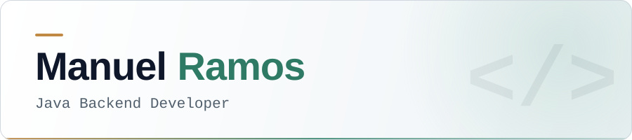

## About

Passionate about software development and continuous learning. I build applications with Java and I'm exploring modern backend technologies. My goal is to write clean, well-tested and maintainable code.

## Tech stack

| Area | Technologies |
| ---- | ------------ |
| **Backend** | Java, Spring Boot, Spring Security, Spring Data JPA, Maven |
| **Databases** | SQL, PostgreSQL, Flyway |
| **Frontend** | Next.js, React, TypeScript, Tailwind CSS |
| **DevOps & tools** | Docker, AWS EC2, Nginx, GitHub Actions, Git |

Most comfortable with Java, Spring Boot, Spring Security, SQL and Git. Still growing in Maven, Docker and testing.

**Foundations:** Object-Oriented Programming · Aspect-Oriented Programming (AOP) · Data Structures · Problem Solving & Logic

## Currently learning

- **Spring Security** — authentication and authorization
- **Advanced SQL** — queries and optimization
- **NoSQL** — document databases
- **Threads** — virtual and platform threads
- **English** — B1+ → B2

## Featured projects

### Habita — Residential complex management platform

Platform to run a residential complex (*propiedad horizontal*): the administrator issues each unit's monthly fee, residents pay it online and book common areas, and security staff control who comes in. It replaces spreadsheets, cash payments and paper logbooks with one system for admins, residents and guards.

- **Online payments with Wompi:** the server sets the amount, signs the checkout and only approves a payment after a signed webhook and a direct check with Wompi confirm status, amount and currency.
- **Security:** JWT access tokens plus rotating refresh tokens, role-based access (`ADMIN`, `RESIDENT`, `GUARD`) on every endpoint.
- **Business rules:** monthly billing with a nightly job that flags overdue accounts, common-area bookings validated against schedules, capacity and overlaps, guest check-in with notifications.
- **Deployed in production:** API in Docker on AWS EC2 behind Nginx with HTTPS (Let's Encrypt), PostgreSQL on Neon, frontend on Vercel. Every push to `main` runs the tests and deploys automatically with a health check and rollback.

| | |
| ---- | ---- |
| **Backend** | Java 25, Spring Boot 4, Spring Security (OAuth2 + JWT), PostgreSQL, Flyway, native SQL |
| **Frontend** | Next.js, React, TypeScript, Tailwind CSS |
| **DevOps** | Docker, AWS EC2, Nginx, Neon, GitHub Actions (CI/CD) |

[Live demo](https://my-project-sable-nine.vercel.app) · [Backend repo](https://github.com/manuel20051208/HorizontalSoftware-Back-End) (with UML, sequence and architecture diagrams) · [Frontend repo](https://github.com/manuel20051208/HorizontalSoftware-Front-End)

### Biz Admin — E-commerce admin panel

Admin panel for an E-commerce that centralizes products, orders, customers, coupons and inventory in a single dashboard. It solves the admin's organization problems by replacing spreadsheets and scattered tools with one place to manage the whole operation.

- **Backend:** Java, Spring Boot, Spring Security, Spring Data JPA, Flyway, SQL
- **Frontend:** Next.js, React, TypeScript, Tailwind CSS
- **DevOps:** Docker, CI/CD (GitHub Actions)

[Live demo](https://application-biz-admin.vercel.app/login) · [Backend repo](https://github.com/manuel20051208/Api-Project) · [Frontend repo](https://github.com/manuel20051208/ApplicationBizAdmin)

## Contact

Thanks for stopping by. Let's build something great together.

